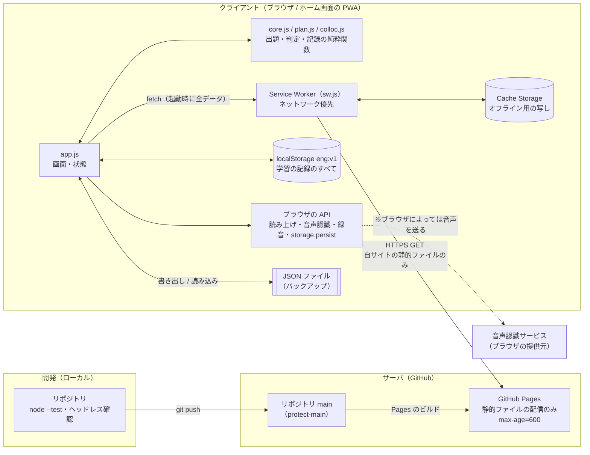

# CLAUDE.md

This file provides guidance to Claude Code (claude.ai/code) when working with code in this repository.

## 概要

英語スピーキング練習用の静的PWA（Research English Drill）。日本の博士課程学生向けで、目標は「国際学会で自分の研究を英語で説明し、質問に簡単な英語で1〜3文で答えられる」こと。

- **今日の練習**: ホームのボタン1つで、学習履歴から組んだ1日分が始まる。順番は 基礎文法 → 研究英語の構文 → 質疑応答の切り返し → Research Q&A。30分でおよそ26問（1問約1分）。
- **Phrase Drill**: 形容詞＋前置詞（interested in など）の英作文と、相槌（Exactly. That's a good point, but… など）を混ぜて10問ずつ練習する。今日の練習には入らない。
- **模擬質疑応答**: 研究についての英語の質問5問に、追加質問を1つずつ続けて、支援なしで答える。今日の練習には入らない。
- **自由に練習**: 「基礎文法（Lv1〜2）」「Lv3 研究ディスカッション」「Lv4 国際学会」「Lv5 博士公聴会」から1つ選んで10問ずつ練習する。

ビルド工程・フレームワーク・依存パッケージはない。GitHub Pages で `main` ブランチのルートから公開しており（https://hamachu216.github.io/english-drill/ 、リポジトリ `hamachu216/english-drill`）、`main` に push するとそのまま本番に反映される。利用者の指定で、PR を作らず `main` に直接コミットして push してよい（テストとヘッドレス確認のあと。push 後は Pages のビルド完了まで確認する）。

## コマンド

```bash
node --test test/*.test.js                         # 全テスト（node --test test/ では動かない）
node --test --test-name-pattern="review" test/plan.test.js   # 名前で絞る
python3 -m http.server 8931 --bind 127.0.0.1       # ローカル確認（fetch() を使うので file:// では動かない）
gh api repos/hamachu216/english-drill/pages/builds/latest --jq '.status+" "+.commit'   # デプロイ状況
```

## アーキテクチャ

### システム構成

サーバ側に処理はない。GitHub Pages は静的ファイルを配るだけで、学習の判断・記録・画面はすべて利用者のブラウザ（クライアント）の中で完結する。



| 要素 | 場所 | 役割 |
|---|---|---|
| GitHub リポジトリ（`main`） | サーバ | ソースとデータの正本。push するとそのまま本番になる（`protect-main` で force push・削除は禁止） |
| GitHub Pages | サーバ | 静的ファイルを HTTPS で配るだけ（`max-age=600`）。API・DB・ログイン・アクセス解析はない |
| Service Worker | クライアント | 自サイトのファイルを、ネットワーク優先で取得してキャッシュに写す。オフラインならキャッシュから返す |
| `app.js` ＋ 純粋関数 | クライアント | 起動時に `data/*.json` を全部 fetch し、出題の組み立て・判定・記録の更新をすべて端末内で行う |
| localStorage `eng:v1` | クライアント | 学習の記録のすべて（下の「保存」）。サーバには送らない |
| ファイルの書き出し・読み込み | クライアント | 端末の移行・消えたときの復元の唯一の手段（サーバ同期はない） |

- **通信**: クライアントからサーバへの通信は、自サイトの静的ファイルの GET だけ。CSP（`connect-src 'self'` ほか `default-src 'none'`）で、外部サイトへの通信・外部スクリプト・外部フォントを読み込めないようにしている。学習の記録はどこにも送信しない。
- **※ 音声認識**: `SpeechRecognition` はブラウザの機能で、ブラウザによっては音声をブラウザの提供元（Chrome なら Google、Safari なら Apple）のサーバに送って文字起こしする。これはアプリの通信ではなくブラウザ側の仕組みで、CSP の対象外。読み上げ・録音・再生は端末内で完結する。
- **更新**: `main` に push → Pages のビルド → 利用者が次に開いたとき、Service Worker が新しいファイルを取得して切り替わる（`controllerchange` で1回だけ再読み込み）。

### クライアント内部のデータの流れ

```
data/*.json ──catalog──▶ cards（全カード。kind・topic・deck・held 付き）
                              │
localStorage "eng:v1" ─restore─▶ state {log, hist, days, session, answers, settings}
                              │
             ┌────────────────┴──────────────────┐
     planSession（今日の練習）            byNeed（自由練習・Phrase Drill）・mockSession（模擬質疑応答）
             └──────────────▶ queue [{id, phase, level?, intro?, follow?, check?, retry?}] ◀┘
                              │  1ステップ＝1画面
                       showStep → reveal → grade
                              │  review（カードの記録）・tally（日次集計）
                              ▼
                     state を保存 → 次のステップ
```

データ → 純粋関数 → DOM の3層。学習の判断（何を出すか、記録がどう変わるか）はすべて純粋関数（`core.js`・`plan.js`・`colloc.js`）にあり、日付・乱数・履歴を引数で受け取る。DOM・ストレージ・時計に触るのは `app.js` だけ。

### ファイル

| ファイル | 役割 |
|---|---|
| `index.html` | マークアップのみ。CSP の `<meta>` もここ |
| `style.css` | 見た目のすべて。色はトークン（`:root` の変数）で定義する |
| `theme.js` | `<head>` で同期読み込み。描画前にテーマを当ててちらつきを防ぐ |
| `core.js` | 汎用の純粋関数: `catalog`、`restore`/`isBackup`、`seeded`、`shuffle`、`nextRound`、ヒント文字列（`skeleton`/`opening`/`mask`/`slots`）、`streak`/`calendar`、`englishVoices`、`wordDiff`、`timeLimit` |
| `plan.js` | 学習アルゴリズム: `review`、`tally`、`shares`/`mix`、`planSession`、`mockSession`、`requeue`、`scaffold`、`choices`、`knownTopics`、`byNeed`、`progress`、`overview`/`weekly`。定数（間隔・配分・1枚の目安秒数・解放条件）はファイル先頭 |
| `colloc.js` | 形容詞＋前置詞: `example`、`hints`、`siblings` |
| `app.js` | DOM と状態のすべて。`<script type="module">` 1つで、トップレベル `await` で全データを fetch する。DOM は `el(tag, props, ...kids)` で組み立て、HTML 文字列は使わない |
| `sw.js` | Service Worker（ネットワーク優先。下の「ハマりどころ」参照） |
| `manifest.webmanifest`、`icons/` | ホーム画面に追加したときのアプリ情報 |
| `test/*.test.js` | `core`・`plan`・`colloc` の単体テスト、データの検査（`data`）、CSP の検査（`security`） |

### データ（`data/`）

どのファイルも `{kind?, level?, title, decks:[{id, title, note?, refs?, cards:[…]}]}` の形。レベル別ファイルの一覧は `core.js` の `FILES`（レベルはその順に 1..N）、それ以外は `DRILLS`。

| ファイル | kind | 量 | カードの形 | 使われ方 |
|---|---|---|---|---|
| `1-basic.json`・`2-advanced.json` | `grammar` | 25トピック・453問 | `{id, ja, en, note?}`。デッキに文法の1行解説 `note`（必須）。研究の場ではまず使わない形（if only・倒置・文学的な分詞構文など）は入れない | 今日の練習・自由練習 |
| `3-discussion.json`〜`5-defense.json` | `phrase` | 30トピック・360問 | 同上 | 自由練習のみ |
| `patterns.json` | `pattern` | 24の型・192文 | `{id, ja, en}`。デッキ＝1つの型（`frame: "We chose this method because ..."`・`ja`・`note`）。`en` は型の書き出しで始まり、`...` に入る語句（`slots`）を取り出せること | 今日の練習 |
| `replies.json` | `reply` | 7場面・63問 | `{id, scene, ja, frame, en}`。決まった返し方（`en`）を読み上げで聞いて書き取る（ディクテーション）。`ja`（意味）を問題文に、`scene`（場面）をその下に表示する。ヒントは英文の頭文字と語の長さ（`skeleton`）だけ。`frame` は答えの後に「答え方の型」として出す | 今日の練習 |
| `qa.json` | `qa` | 10話題・70問 | `{id, q, ja, points, frame, en, more}`（英語の質問・意味・答えに入れる要素・答え方の型・1文の回答例・続き）。自分の研究について答える問題で、`points` はどの研究にも当てはまる言い方にする（架空の研究の中身を書くと、その答えを再現する問題になってしまう）。`en`・`more` は架空の研究にもとづく参考。デッキの `follow:[{q, ja, points, frame, en}]` は模擬質疑応答の追加質問で、同じ話題のどの質問の後でも通じる言い方にする | 今日の練習・模擬質疑応答 |
| `collocations.json` | `colloc` | 96組・例文288 | `{id, adj, prep, collocation, ja, difficulty, note, examples:[{id, scene, en, ja, also?}]}`。デッキ＝前置詞（デッキ名が答えなので出題中は表示しない） | Phrase Drill のみ |
| `backchannels.json` | `backchannel` | 7機能・42問 | `{id, said, saidJa, ja, en}`。デッキ＝相槌の機能（同意・一部同意・理解・驚き・つなぎ・反対・否定疑問への答え）で、`basic`（自分から言う言い方）・`more`（聞いて分かればよい言い方）・`note`（硬さや使い分け）を持つ。`said` は相手のひと言（表示して読み上げる。意味は `saidJa`）、`ja` は返す内容（問題文）、`en` はその英語で、相槌＋続きのひと言。どれかの `basic`/`more` で始まる（テストで検証）。返す内容の日本語は機能ごとに書き出しをそろえ（その通りです／良いご指摘ですが／なるほど／えっ、本当ですか／そうですね…／それはどうでしょうか／はい・いいえ）、どの相槌を使うかが分かるようにする | Phrase Drill のみ |

- **ID**: カードIDは `<deckId>-NNN` で全ファイルを通じて一意（テストで検証）。学習履歴のキーなので、既存カードのIDは変えないこと。
- **取り置き**: 各デッキの最後の2枚は週1回の初見チェック用（`catalog` の `held`。形容詞＋前置詞は対象外）。カードを足すときは途中に入れるか、末尾2枚が初見用になることを踏まえる。
- **形容詞＋前置詞の例文**: `en` には「形容詞 前置詞」がこの綴りのまま隣り合って入る（回答例で強調するため。テストで検証）。`also` はその文でほかにも自然に使える前置詞で、回答例の下に「この文では … も使えます」と出す。組み合わせの選定は EnglishClub の一覧を参考にしたが、例文・訳・解説はオリジナル。
- **切り返しの定型句**: Wordvice の資料「研究発表の質疑応答対処法」の定型句は利用者の指定で必須として収録している（質問例は、書き取りでは表示しないので収録をやめた）。`test/data.test.js` の `HANDOUT` が、どれも取り置きでないカードに入っていることを検証する（綴りの誤り rational / identity は直した。命令調でぶっきらぼうなもの — Please speak slowly and clearly. / I'd rather discuss … — は利用者の指定で丁寧な言い方に変えた）。場面・具体的な中身・訳はオリジナル。

### 今日の練習（`planSession`）

| kind | 枠の決め方 | 1枚の目安 | 新しいカードの順 | 支援（`scaffold`） | 記録の進め方 |
|---|---|---|---|---|---|
| `grammar` | 配分の中 | 60秒 | まだ得意でないトピックをファイル順に3つずつ（`ROTATION`）、その中で1枚目 → 2枚目 …。得意になったトピックは抜けて次が入る（Lv2 は Lv1 がほぼ得意になってから） | ヒント: 出だし → 頭文字 | `review` |
| `pattern` | 配分の中 | 75秒 | 始めた型の続き → 全部の型を1回言えたら新しい型を1〜2個 | 型の表示 → 半分隠す → なし。ヒント: 型 → 語句 → 頭文字 | `review` |
| `reply` | 6分に1問（30分なら5問） | 60秒 | 各場面の1枚目 → 2枚目 … | 書き取り。意味と場面を表示し、返事を自動で読み上げる（🔊で何度でも）。ヒント: 頭文字と語の長さ | `review` |
| `qa` | 配分の中 | 120秒 | 各話題の1枚目 → 2枚目 … | Beginner（入れる要素＋型）→ Intermediate（入れる要素、45秒のゆるいバー）→ Advanced（質問のみ） | `review` |

- **順番**: 前回言えなかったカード（phase `review`）→ 基礎文法 → 構文 → 切り返し → Q&A → 週1回の初見チェック。
- **配分**（`shares`/`mix`）: 枠の外の切り返しを除いた時間を、既定で 基礎:構文:Q&A ＝ 15:10:5 に分け、上の秒数（言う・回答例と解説を読む・自己評価するまでの実際の所要時間）で枚数に換算する。前回言えなかったカードもこの枚数の中に入る（上乗せしない）。直近2週間の出来で動き、基礎が悪いと基礎が増え（上限65%）、良いと研究英語が増える（下限30%）。構文が良いほど研究英語のうち Q&A が増える。どの種類も最低1枚は入る。
- **選び方**（種類ごと）: 期限が来た復習（箱の低い順）→ いちばん苦手なトピック（言えなかったカードが2枚以上）のまだ出ていない文を少し → 新規 → 何もなければ最後に練習した日が古い順。復習の山が2セッション分未満なら、枠の1/4は新規用に空ける。ただし前回言えなかったカードはこの空きより優先し、枠に入るだけ必ず翌日に出す。
- **得意なトピック**（`knownTopics`）: 3問以上答えて、すべて最後の回答がヒントなしの「言えた」で、言えなかった文がない文法トピック。その新規は他のトピックの新規をすべて出した後に回す。1問でも言えなくなれば元に戻る。ホームの「いまの状況」に表示する。
- **新しい型**: 1枚目は「聞いてまねする」導入画面（`intro`。例文を読み上げ、語句を強調。採点なし）。その文は翌日以降に思い出す問題として出し、当日は別の4文を言う。
- **模擬質疑応答**（`mockSession`、今日の練習の外）: Q&A の質問を話題をまたいで5問（答えたことのある質問を優先し、足りなければ新しい質問）、英語のみで出し、それぞれに同じ話題の追加質問を1つ続ける。記録は Q&A と同じく `review` で進む（追加質問は記録しない）。保存されず、言えなかった問題のやり直しもない。以前は今日の練習の中の「即興Q&A」だったが、新しい質問が支援なしで割り込み、問題数も読めなくなるので独立させた。
- **初見チェック**: 初回の練習日から7日ごと。取り置きの未出題カード（基礎3・構文2・切り返し1・Q&A1）を支援もヒントもなしで出す。
- **やり直し**（`requeue`）: 言えなかったカード（ヒントで言えたものは除く）は同じセッション中に1回だけもう一度出す。Q&A はすぐ次で支援を全部見せ、それ以外は4枚後（構文は型と語句、文法は1行解説と出だしを最初から見せる）。
- **再現性**: 日付をシードにした乱数（`seeded`）で組むので、ホームに表示したメニューと実際に始まるセッションは一致する。

### 記録の進め方

- **`review`**（全種類）: 言えなかった → 翌日（箱0）。言えた → 箱+1（3・7・14・30・60日）。ヒントで言えた → 箱+1 だが7日止まり（初回なら3日後）。翌日に戻るのは言えなかったカードだけ。箱が上がるのは期限が来た日（か初回）だけで、同じ日に何度正解しても進まない。
- **形容詞＋前置詞**（Phrase Drill のみ）: 覚える単位は文ではなく組み合わせで、出るたびに別の例文（`example`）を日本語から英文全体で言う。以前は空所に前置詞だけを入れる段階があったが、前置詞だけでは身につかないので廃止した。その頃の記録に残る `step`・`wins` は読まない。
- **`tally`**: その日の集計を足す。最初の回答だけを数える。

### 回答と判定

- **流れ**: 出題 → 声に出す（入力・🎤は任意）→「回答した」→ 回答例 → 自己評価。「わからない」を押すと答えを表示し、「言えなかった」として記録する。
- **ヒント**: 頭文字のある種類（Q&A 以外）は、ヒントを1回押すと頭文字まで（それより前のヒントも）まとめて出る。上の表などの「→」はその並び順。頭文字のない Q&A は1回に1つずつ。
- **自己評価**（`choices`）: 言えなかった / ヒントで言えた / 言えた の3つ。ヒントを使ったら「言えた」は出ない。Q&A では「言えなかった」が「内容が浮かばなかった」「英文にできなかった」に分かれる。
- **秒数は測らない**: 以前は回答までの秒数で「自力 / 時間はかかった」を分けていたが、ややこしく意味も薄かったので廃止した。保存済みの記録の grade 3（自力）は `restore` が 2（言えた）に直す。
- **流暢さ優先**: 音声認識の結果は表示するだけで判定には使わない。Q&A では回答と模範の差分も出さない（模範は架空の研究の参考なので、比べても意味がない）。

### 自由練習と Phrase Drill

選んだ組（基礎文法 = Lv1〜2 まとめて、Lv3〜5、または全組み合わせ）を `byNeed` の順に並べる: 前回間違えた → 期限の来た復習 → 新規（今日の練習と同じ順。初見チェック用の取り置きは使わない）→ 残りを練習が古い順。この順の `pool` から `ROUND`（10）問ずつ出し、言えなかった問題だけを全部言えるまで繰り返す（`nextRound`）。回答はカードの記録と日次集計に反映されるが、ラウンドの進行自体は保存しない。`settings.level` の 1 と 2 はどちらも基礎文法を指す。Phrase Drill は形容詞＋前置詞と相槌を、それぞれ `byNeed` の順のまま交互に出す（`alternate`）。相槌は返す内容（`ja`）を問題文にし、相手のひと言（`said`）を下に表示して読み上げる。機能名は答えのヒントになるので出さない。ヒントは相手の言葉の意味 → 基本の相槌 → 頭文字。相槌は同じ機能の言い方ならどれでも正解。答えの後に機能の言い方の一覧と使い分けを出す。

### 保存

localStorage のキー `eng:v1` 1つに次を入れる。形は `restore` が決める。旧版の `{log, settings}` だけのデータもそのまま読め、無くなった設定は捨てる。

- `log: {"YYYY-MM-DD": その日の回答数}` — 連続日数とヒートマップ用。
- `hist: {cardId: {box, n, last, due, grade}}`（grade: 0 言えなかった・1 ヒント・2 言えた） — カードごとの記録。
- `days: {"YYYY-MM-DD": {topicId: [回答数, ヒントなしで言えた], "#check": [出題, 言えた], "#why": [内容, 英文]}}` — 1回目の回答だけを数えた日次カウンタ。値がすべて数値配列なので、日の合算も週の合算も同じ足し算。秒数を測っていたころの `[回答数, 時間はかかった, 自力]` と `#time:*`・`#start` は `restore` が変換・削除する。
- `session: {day, queue, idx, grades}` — 今日のセッション。1問ごとに保存するので、中断・再読み込み後に続きから再開できる。日付が変わると無視される。
- `answers: {cardId: 自分の回答例}` — Q&A の答えの後に「この答えを回答例にする」を押して保存した自分の答え。次からその質問の答えの後に、架空の研究の参考より先に出す。実際の研究内容が入るので、端末とバックアップの外には出さない。
- `settings: {theme, level, limit, voice, minutes, listen}`。

記録はブラウザの中にしかないので、消えないように2つ対策している。

- 練習を始めるタップで `navigator.storage.persist()` を頼み、容量不足による自動削除から外す（Firefox では許可のダイアログが出る）。
- 「記録のバックアップ」で状態全体を JSON に書き出し、読み込みで丸ごと置き換える（確認ダイアログあり。中身は `isBackup` で形を検査してから `restore` を通す。`restore` は外から来たデータの唯一の関門で、型の合わない項目（数値でない回答数、`box`・`due`・`last` の揃わない記録、数値配列でない集計など）を捨てる）。

iPhone の Safari は7日間開かないサイトの記録を消すが、ホーム画面に追加したアプリは対象外。

### 画面

画面は3つの `<section>`（`home`、`study`、`result`）を `hidden` で切り替える。多くの要素が `display` を指定しているため、グローバルの `[hidden]{display:none!important}` が必要。

- **ホーム**: `#home` の直下にカードを1枚ずつ並べたグリッド（カードの間隔はグリッドの `gap` で取り、カード自身に余白を持たせない）。見出しはカードの中に置く。スマホ幅では HTML の順に1列: 進捗（`.hero`）・今日のメニュー（`.menu`）・Phrase Drill（`.drill`。見出しと1行の要約と開始ボタンだけ）・模擬質疑応答（`.mock`）・いまの状況（`.now`）・週ごとの変化（`.weekly`）・学習の記録（`.history`）・自由に練習（`.free`）・設定（`.settings`）・記録のバックアップ（`.backup`）・参考サイト（`.sources`）。
- **PC（幅 960px 以上）**: 最大 90rem まで横に広げる。ホームは2列で、`grid-template-areas` により1行に2枚ずつ（進捗｜Phrase Drill と模擬質疑応答を縦に2枚（進捗は2行分の高さ）、メニュー｜いまの状況、学習の記録｜週ごとの変化、自由に練習｜バックアップ、設定｜参考サイト）。同じ行のカードは上端も下端もそろう。開閉する `details` だけは `align-self: start` で、片方を開いても隣は伸びない。
- **出題画面**: PC では `#qcard` を「問題・回答 | 回答例・自己評価」の2列にする。

## ハマりどころ

- **Service Worker**（`sw.js`）: ネットワーク優先で `cache: 'no-cache'` を付けて取得し、`skipWaiting` と `clients.claim` を使う。`app.js` は `controllerchange` で1回だけ再読み込みする。GitHub Pages は `max-age=600` を返すため、この組み合わせでデプロイが次の再読み込みで反映される。キャッシュ優先や stale-while-revalidate に戻さないこと（以前それで利用者が古いコードから抜けられなくなった）。
- **読み上げの声**: 声を指定しないと、macOS の Chrome はかすれ声のジョーク用音声「Albert」を使う。ジョーク用音声は名前がローカライズされる（例: ささやき声）ため除外リスト方式は使えない。`englishVoices` は品質の良い声の許可リストだけを残し、未知の環境では任意の英語音声にフォールバックする。
- **制限時間**: `#timer` に CSS の `@keyframes drain` アニメーションを掛け、答えを表示したら `animationPlayState` で止める。自由練習（Phrase Drill を除く。英作文と相槌なので時間で切らない）ではこれとは別に `setTimeout` を1つ置き、時間切れで `reveal(true)` を呼ぶ（既定は10秒。`'auto'` は 2秒 + 1単語0.5秒）。時間切れは答えを見せるだけで、判定は自己評価。今日の練習では時間で打ち切らない（Intermediate の Q&A にバーが出るだけ）。
- **話すのが先**: 回答は声に出すだけでよく、入力は任意（以前あった「英語を入力するまで答えを見られない」制限は、音声認識のない端末で詰むので外した）。🎤 は SpeechRecognition があれば文字起こし、なければ MediaRecorder で録音して回答例の横で再生する。どちらも無い端末ではボタンが出ないだけで練習は完了できる。録音の再生のために CSP に `media-src blob:` がある。
- **テーマ**: 色は `:root` の CSS カスタムプロパティで定義する。ダークモードは `@media (prefers-color-scheme: dark) :root:not([data-theme="light"])` と `:root[data-theme="dark"]` の2か所で再定義しているので、両方を必ず揃えること。レベルごとのアクセント色は `--lv1`〜`--lv5` で、`--lv` 経由で適用する。
- **問題文**: 必ずオリジナルで書く（例外は上の `replies.json` の定型句だけ）。`refs` に載せた参考サイトは分野構成の参考にしただけで、文をコピーしてはいけない。リポジトリは public なので、カードに利用者の実名や所属、実際の研究内容・結果を入れないこと（構文とQ&Aの例は架空の研究で、型を使い回す練習用）。
- **CSP（セキュリティ）**: リポジトリは public で、`main` がそのまま本番になる。`index.html` 先頭の `<meta>` CSP は `default-src 'none'` で、自サイトの読み込みと Trusted Types（`require-trusted-types-for 'script'`）だけを許可している。外部の CDN・フォント・インラインコード・`innerHTML` を足すと動かなくなる（`test/security.test.js` でも検査している）。Service Worker の登録だけは `sw` ポリシーを通す。フォントは端末のもの（Apple 端末ではヒラギノ丸ゴ）を使い、Google Fonts は外部への通信をなくすためにやめた。`main` はルールセット `protect-main` で force push と削除を禁止している。コミットのメールアドレスは GitHub の noreply アドレスにする。
- **ヘッドレス確認**: 画面の確認は `playwright-core` でローカルの Chrome を動かして行う。依存パッケージを持たない方針なので、`playwright-core` はこのリポジトリに入れず、作業用の一時フォルダに入れること。
